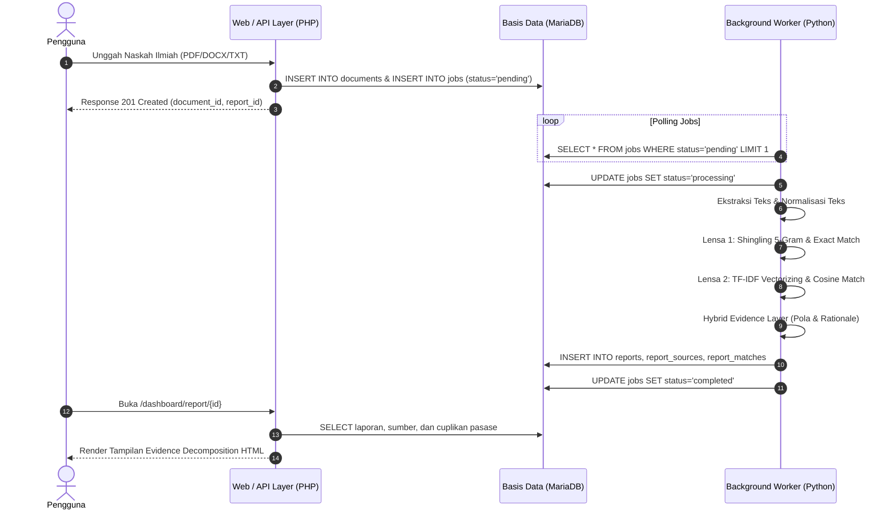

# Arsitektur Sistem AR Tilik (v1.0.0-RC)

Dokumen ini mendokumentasikan arsitektur sistem, komponen perangkat lunak, skema basis data, dan aliran data operasional pada **AR Tilik v1.0.0**.

---

## 1. Ikhtisar Arsitektur

AR Tilik dibangun di atas arsitektur hibrida terdistribusi yang memisahkan antara **antarmuka web berbasis PHP (CodeIgniter 4)** dan **mesin komputasi latar belakang berbasis Python 3**:

```
[ Klien / Web Browser ]
        │
        ▼ (HTTP / REST)
┌────────────────────────────────────────────────────────┐
│        CodeIgniter 4 Web & API Layer                   │
│  - Document Upload & Validation                        │
│  - Job Scheduling (`jobs` table)                       │
│  - Dashboard & Evidence Decomposition Report View      │
└──────────────────────────┬─────────────────────────────┘
                           │
                           ▼ (SQL Transaction)
┌────────────────────────────────────────────────────────┐
│           MariaDB / MySQL Database Layer               │
│  - `documents`, `document_pages`, `document_chunks`    │
│  - `fingerprints`, `fingerprint_documents`, `stats`    │
│  - `jobs`, `reports`, `report_sources`, `matches`      │
└──────────────────────────┬─────────────────────────────┘
                           │
                           ▼ (Background Worker Polling)
┌────────────────────────────────────────────────────────┐
│        Python 3 Worker & Evidence Layer                │
│  - Task Queue Worker Daemon (`worker.worker`)          │
│  - Text Normalization & 5-Gram Shingling Engine        │
│  - Exact Matcher & Union Coverage (`worker.matcher`)   │
│  - Sparse TF-IDF Cosine Vectorizer (`worker.tfidf`)    │
│  - Hybrid Evidence Layer (`worker.hybrid`)             │
└────────────────────────────────────────────────────────┘
```

---

## 2. Rincian Komponen Perangkat Lunak

### A. Lapisan Antarmuka Web (PHP 8.1+ & CodeIgniter 4)
- **Framework**: CodeIgniter 4.6+
- **Styling**: Tailwind CSS (Desain modern, responsif mobile/desktop)
- **Controller Utama**:
  - `app/Controllers/Api/DocumentController.php`: Menangani upload dokumen via multipart form, validasi MIME/ekstensi (.pdf, .docx, .txt), penyimpanan fisik ke `writable/documents/`, dan pembuatan tiket antrean `jobs`.
  - `app/Controllers/Api/ReportController.php`: Endpoint pengecekan status laporan dan trigger similarity check.
  - `app/Controllers/DashboardController.php`: Menampilkan dashboard daftar karya ilmiah, tab korpus, dan halaman dekomposisi bukti laporan (`/dashboard/report/{id}`).
- **Model Basis Data**:
  - `DocumentModel`, `ReportModel`, `ReportSourceModel`, `ReportMatchModel`, `FingerprintModel`, `DocumentPageModel`, `DocumentChunkModel`.

### B. Lapisan Mesin Komputasi (Python 3.12+)
- **Daemon Antrean (`worker/worker.py`)**:
  - Memantau antrean `jobs` berstatus `pending` secara non-blocking.
  - Menandai job menjadi `processing`, mengeksekusi pipeline ekstraksi dan komputasi bukti, serta memperbarui status menjadi `completed` atau `failed`.
- **Text Normalizer & Extractor (`worker/extractor.py`, `worker/normalizer.py`)**:
  - Ekstraksi teks dari PDF (PyMuPDF/PDFPlumber), DOCX (python-docx), dan TXT.
  - Normalisasi teks: lowercase, pembersihan karakter non-alfanumerik tanpa merusak struktur makna, penghilangan spasi ganda.
- **Sequential Exact Matcher (`worker/matcher.py`, `worker/shingler.py`)**:
  - Membentuk shingle kata 5-gram bergeser.
  - Melakukan hash FNV-1a 32-bit untuk setiap shingle.
  - Menghitung rentang kata yang cocok (*contiguous word segments*).
  - Melakukan penggabungan rentang (*range merging*) untuk menghitung persentase cakupan gabungan (*union coverage*) tanpa *double-counting*.
- **Lexical TF-IDF Vectorizer (`worker/tfidf.py`)**:
  - Menghitung frekuensi kemunculan kata pada korpus (*Document Frequency*).
  - Membentuk tabel IDF baku dengan perataan (*smooth IDF*):
    $$\text{IDF}(t) = \ln\left(1 + \frac{N}{\text{DF}(t)}\right) + 1.0$$
  - Membentuk representasi vektor jarang (*sparse vector*) untuk dokumen submisi dan setiap dokumen korpus.
  - Menghitung kemiripan kosinus (*cosine similarity*):
    $$\cos(\vec{u}, \vec{v}) = \frac{\vec{u} \cdot \vec{v}}{\|\vec{u}\| \|\vec{v}\|}$$
- **Hybrid Evidence Layer (`worker/hybrid.py`)**:
  - Menormalisasi hasil ke kontrak bukti terpadu `EvidenceContract`.
  - Menerapkan aturan penggabungan bukti eksplisit (*rule-based aggregation*).
  - Menentukan pola bukti (*evidence pattern*), keputusan (*decision*), kesepakatan sumber (*source agreement*), dan merumuskan penjelasan rasional transparan (*explainability rationale*).

---

## 3. Skema Basis Data Inti (`db_artilik`)

| Nama Tabel | Peran Utama |
|---|---|
| **`documents`** | Metadata dokumen karya ilmiah (judul, nama file asli, ukuran, path penyimpanan, tipe: submission/corpus, status indeks, visibilitas). |
| **`document_pages`** | Teks per halaman dokumen hasil ekstraksi. |
| **`document_chunks`** | Potongan teks berurutan (500–1000 kata) lengkap dengan posisi kata awal dan akhir. |
| **`fingerprints`** | Fingerprint hash FNV-1a dari shingle 5-gram beserta posisi kata dalam dokumen. |
| **`fingerprint_documents`** | Tabel relasi many-to-many antara fingerprint dan dokumen sumber untuk pencarian indeks terbalik (*inverted index*). |
| **`fingerprint_stats`** | Statistik frekuensi kemunculan fingerprint di seluruh korpus (*document frequency*). |
| **`jobs`** | Antrean pekerjaan asinkron (`index_corpus`, `similarity_check`) dengan mekanisme *retry* dan *status tracking*. |
| **`reports`** | Laporan hasil telaah: persentase exact, persentase kosinus, skor keseluruhan, pola bukti, keputusan, rasional, dan payload JSON `evidence_data`. |
| **`report_sources`** | Peringkat dokumen sumber yang beririsan dengan submisi (exact %, cosine %, jumlah kata cocok). |
| **`report_matches`** | Rincian setiap fragmen pasase yang cocok: nomor kata awal/akhir submisi vs sumber, panjang kata, dan skor signifikansi. |
| **`benchmark_runs`** & **`benchmark_results`** | Log riwayat eksekusi benchmark laboratorium terstandarisasi. |

---

## 4. Aliran Siklus Pemrosesan Data (Data Lifecycle)



---

## 5. Keamanan & Proteksi Transaksional

1. **MySQL Snapshot Isolation**:
   Koneksi worker dan testing secara eksplisit mengaktifkan `autocommit = True` untuk menghindari staleness pembacaan data akibat isolasi `REPEATABLE READ` bawaan InnoDB saat melakukan polling berulang.
2. **Perlindungan Kredensial**:
   Berkas `.env` dipisahkan secara ketat dari repositori melalui `.gitignore`. Kredensial basis data hanya disalin dari `.env.example`.
3. **Pembersihan Data Otomatis**:
   Sub-perintah `./artilik regression --cleanup` memastikan seluruh tabel turunan dibersihkan melalui relasi foreign-key yang aman, mencegah akumulasi sampah data uji.
